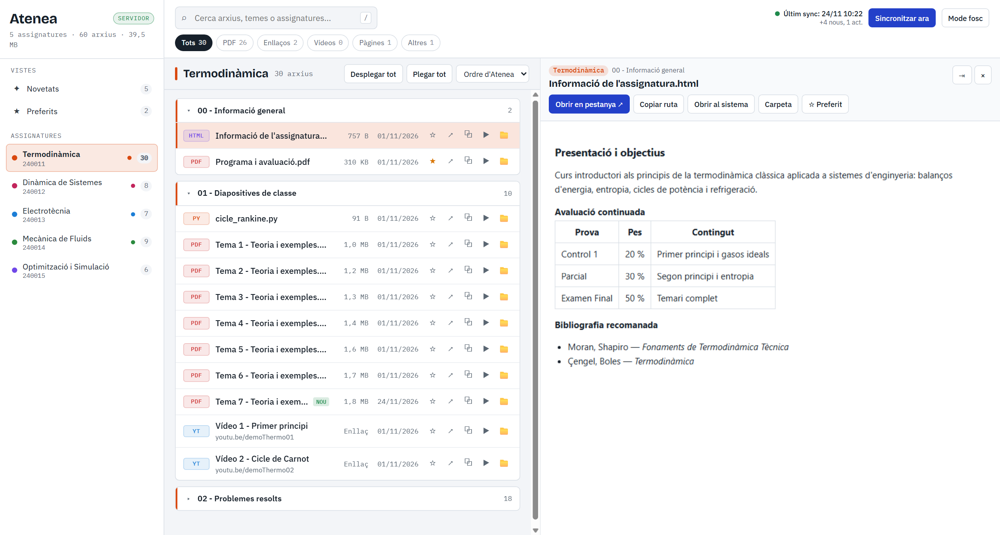
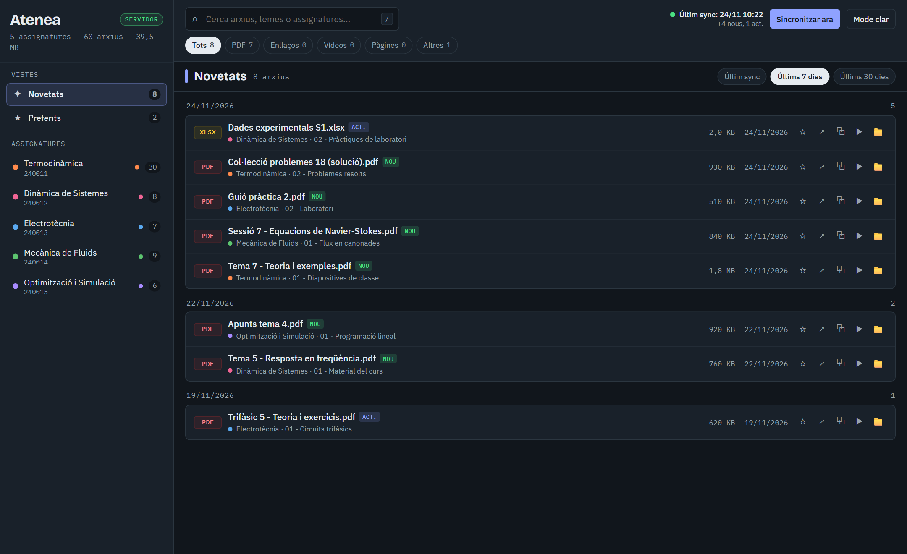

# Atenea Local UI

Sincronitzador automàtic dels documents d'[Atenea (Moodle UPC)](https://atenea.upc.edu) —i compatible amb qualsevol altre Moodle— amb un visor web local en català, 100% offline i sense dependències externes.

### Captures de pantalla

**Vista d'assignatura amb previsualització lateral i desplegables intel·ligents (mode clar)**



**Vista de novetats i estat de sincronització (mode fosc)**



## Per què és millor que entrar directament a Atenea / Moodle?

- **Instantani i 100 % local (offline)**: obre PDFs, apunts, pàgines i vídeos al moment des del disc, sense esperes ni haver de fer login CAS cada sessió, i funciona fins i tot sense internet.
- **Cerca global real (`/` o `Ctrl+K`)**: troba qualsevol arxiu entre totes les assignatures a l'instant, sense distingir accents ni majúscules i filtrant per tipus (`PDF`, `Enllaços`, `Vídeos`, `Pàgines`, `Altres`).
- **Novetats centralitzades**: consulta en una sola pantalla tot el que s'ha penjat o actualitzat a l'últim sync o als darrers 7/30 dies, sense haver d'entrar assignatura per assignatura.
- **Preferits (`★`)**: fixa formularis, temaris, guions o exàmens clau a un sol clic.
- **Arxius reals, editables i permanents**: tot es desa en carpetes normals dins d'`Assignatures/`; pots subratllar PDFs, obrir Excels, Words o codi amb l'app nativa del sistema i conservar la còpia encara que un professor retiri un document o s'acabi el quadrimestre.
- **Interfície neta, ràpida i 100 % editable**: panell de previsualització lateral, desplegables intel·ligents (`> 15` fitxers plegats per defecte) que recorden com els vas deixar, mode clar/fosc i tot en un sol `index.html` + scripts Python sense dependències per poder adaptar colors, noms (`subjects.json`) o funcions al teu gust.

## Funcions principals

- **Sincronització diària (`sync_atenea.py`)**: descarrega apunts, carpetes, enunciats de tasques, pàgines HTML i enllaços `.url` organitzats per assignatura i secció dins d'`Assignatures/`. Si un professor esborra un fitxer d'Atenea, la còpia local es conserva.
- **Índex local (`build_index.py`)**: escaneja `Assignatures/` i analitza `sync.log` per generar `catalog.js` amb tota la informació necessària per a la interfície web.
- **Visor web (`index.html`)**:
  - **Novetats**: fitxers de l'última sincronització, dels darrers 7 dies o 30 dies.
  - **Preferits**: marca fitxers clau amb estrella (`localStorage`).
  - **Cerca global instantània**: sense distinció de majúscules ni accents (`/` o `Ctrl+K`), amb filtres per tipus (`PDF`, `Enllaços`, `Vídeos`, `Pàgines`, `Altres`).
  - **Previsualització integrada**: PDFs en panell lateral, pàgines HTML de Moodle renderitzades en UTF-8 dins d'un `iframe` aïllat, imatges, vídeos, arxius de text/codi i obertura directa dels enllaços `.url`.
  - **Desplegables intel·ligents**: seccions i subcarpetes amb més de 15 arxius plegades per defecte, amb memòria de l'estat obert/tancat.
  - **Tema clar / fosc**: adaptat automàticament al sistema o seleccionable des de la barra superior.
- **Servidor local opcional (`serve.py` + `obrir_atenea.bat`)**:
  - Afegeix botó **Sincronitzar ara** des de la UI.
  - Permet **Obrir al sistema** (Word, Excel, MATLAB, etc.), **Mostrar a la carpeta** a l'Explorador de Windows, reproducció de vídeo amb peticions `Range` i persistència de l'estat dels desplegables a `ui_state.json`.

## Compatible amb qualsevol Moodle

Tot i estar pensat inicialment per a Atenea (UPC), el sincronitzador fa servir els **Moodle Mobile Web Services** estàndard (`core_webservice_get_site_info`, `core_enrol_get_users_courses`, `core_course_get_contents`, `mod_assign_get_assignments`). Per tant, funciona amb **qualsevol campus virtual Moodle** d'una universitat, institut o escola que tingui activada l'API mòbil (Atenea UPC, UB, UAB, UPF, etc.).

- En executar `python get_token.py`, només cal escriure la URL base del teu Moodle (o prémer `Enter` per utilitzar `https://atenea.upc.edu` per defecte), que quedarà desada a `"base_url"` dins de `config.json`.
- Si el teu Moodle no utilitza l'enllaç de l'app mòbil (`launch.php`), també pots obtenir el token del servei **`Moodle mobile web service`** des del teu perfil del campus (*Preferències → Claus de seguretat*) i posar manualment `{"base_url": "https://el-teu-moodle.edu", "token": "..."}` dins de `config.json`.

## Requisits

- Python 3.9 o superior (només llibreria estàndard, no cal instal·lar cap paquet).
- Windows per a `obrir_atenea.bat` i `run_sync.ps1` (els scripts Python funcionen igualment a Linux/macOS).

## Inici ràpid

1. **Obtén el token del teu Moodle** (la primera vegada o quan caduqui):
   ```powershell
   python get_token.py
   ```
   Introdueix la URL del teu Moodle (per defecte `https://atenea.upc.edu`) i segueix les instruccions. Això crea `config.json` en local amb el teu token (no es puja mai a Git).

2. **Sincronitza les assignatures i genera l'índex**:
   ```powershell
   python sync_atenea.py
   python build_index.py
   ```

3. **Obre el visor**:
   - **Mode estàtic**: fes doble clic a `index.html`.
   - **Mode servidor local (recomanat)**: fes doble clic a `obrir_atenea.bat` (o executa `python serve.py`).
   - **Drecera d'escriptori a Windows (sense consola)**: pots crear un accés directe apuntant a `pythonw.exe` amb argument `"C:\ruta\a\serve.py"` i la icona `atenea.ico` inclosa al repositori (`serve.py` també la serveix com a favicon).

## Automatització diària a Windows

Pots crear una tasca al **Programador de tasques (Task Scheduler)** de Windows que executi:

```powershell
powershell.exe -NoProfile -ExecutionPolicy Bypass -WindowStyle Hidden -File "C:\ruta\a\run_sync.ps1"
```

Si també fas còpia de seguretat dels teus documents en un repositori privat propi, pots passar el paràmetre `-GitPush` a `run_sync.ps1`.

## Personalitzar noms i colors d'assignatures (opcional)

Pots crear un fitxer local `subjects.json` (ignorat per Git) mapejant el codi d'assignatura o el nom de la carpeta a un nom curt i colors clar/fosc:

```json
{
  "240052": ["Termodinàmica", "#D9480F", "#FF8A4C"],
  "240043": {
    "name": "Dinàmica de Sistemes",
    "colorLight": "#C2255C",
    "colorDark": "#F06595"
  }
}
```

## Seguretat i privacitat

- `Assignatures/`, `config.json`, `sync.log`, `catalog.js`, `ui_state.json` i `subjects.json` estan exclosos a `.gitignore`.
- `build_index.py` només llegeix `max_repo_file_mb` de `config.json`; el token no s'inclou mai a `catalog.js`.
- `serve.py` només escolta a `127.0.0.1`, bloqueja el traversal de rutes i l'accés a fitxers fora d'`Assignatures/`, i exigeix validació de capçaleres locals per a les accions `POST /api/*`.
